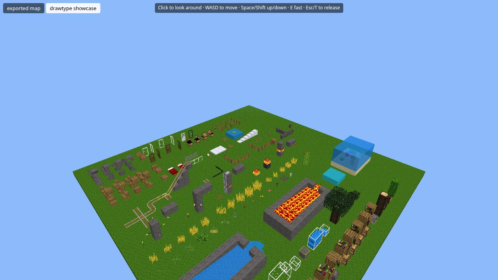

# luanti-viewer

A browser-based 3D viewer for [Luanti](https://www.luanti.org/) (formerly Minetest) maps, built on [three.js](https://threejs.org/).

It renders exported mapblocks with the node definitions, textures and models of the game they came from. It supports every drawtype (nodeboxes, meshes, liquids, plants, glass, ...), texture modifiers, animated tiles and `param2` rotations and colors.




## Usage

The package is published to [npm](https://www.npmjs.com/package/@buckaroobanzay/luanti-viewer):

```bash
npm install @buckaroobanzay/luanti-viewer three
```

`three` is a peer dependency, so your application provides it.

`createView` renders a scene into any element. The library doesn't fetch anything itself: you provide three async callbacks that load node definitions, mapblocks and media (textures and models), so the data can come from static files, an API or anywhere else.

```html
<div id="view" style="width: 100%; height: 600px"></div>
```

```ts
import { createView, parseMapblock, type NodeDefinition } from "@buckaroobanzay/luanti-viewer"

const BASE = "https://example.com/export/"

// node name -> definition, as written by the export mod
const nodedefs: Record<string, NodeDefinition> = await fetch(BASE + "nodedefs.json").then(r => r.json())

createView(document.getElementById("view")!, {
    // called once per node name, null for unknown nodes
    getNodeDefinitions: async name => nodedefs[name] ?? null,

    // null if the mapblock does not exist
    getMapblock: async pos => {
        const response = await fetch(`${BASE}mapblocks/(${pos.x},${pos.y},${pos.z}).json`)
        return response.ok ? parseMapblock(await response.text()) : null
    },

    // textures (.png) and models (.obj / .b3d) by file name
    getMedia: async filename => {
        const response = await fetch(`${BASE}media/${encodeURIComponent(filename)}`)
        return response.ok ? response.blob() : null
    },

    // scene bounds in mapblock coordinates
    minPos: { x: -5, y: -2, z: -5 },
    maxPos: { x: 5, y: 3, z: 5 },

    // optional: only load mapblocks within this radius (in mapblocks) around the camera
    viewRange: 8,

    // optional: initial camera position and look-at point in node coordinates
    camera: {
        position: { x: 40, y: 30, z: 40 },
        target: { x: 0, y: 5, z: 0 }
    },

    // optional
    showFPS: true,
    // optional: initial time of day, 0 = midnight, 0.5 = noon (default)
    timeOfDay: 0.5,
    events: {
        // reported after every frame in which the camera moved or turned,
        // can be passed back as `camera` to restore the view
        camera: camera => console.log(camera)
    }
})
```

`createView` returns a handle to change the time of day later on, the sunlight fades while artificial light keeps its brightness:

```ts
const viewer = createView(element, options)
viewer.setTimeOfDay(0) // midnight
viewer.setCollision(true) // walking mode, same as the `collision` option
viewer.setNoclip(true) // the flying camera passes through the terrain, same as the `noclip` option
```

Mapblocks that change while the view is open can be pushed with `updateMapblock`, for example from a WebSocket. The mapblock and its neighbors are rendered again, `null` removes it. Updates for mapblocks that are not loaded are ignored, `getMapblock` should return the current version when they come into range:

```ts
socket.onmessage = event => {
    const { pos, data } = JSON.parse(event.data)
    viewer.updateMapblock(pos, data ? parseMapblock(data) : null)
}
```

The viewer cleans up after itself (renderer, event listeners, GPU resources) once the element is removed from the document.

### Controls

Click into the view to capture the mouse and look around.

| Key         | Action             |
|-------------|--------------------|
| W A S D     | move               |
| Space/Shift | up / down          |
| E           | move faster        |
| C           | toggle walking mode (gravity and collision, Space jumps) |
| H           | toggle noclip (the flying camera passes through the terrain) |
| Esc / T     | release the mouse  |

On touch devices a tap into the view shows on-screen controls instead (disable them with `touchControls: false`),
the page scrolls as usual with touches on the view until then:

| Touch                 | Action             |
|-----------------------|--------------------|
| drag on the left half | move (joystick)    |
| drag anywhere else    | look around        |
| ▲ / ▼                 | up / down, ▲ jumps in the walking mode |
| Fast                  | toggle moving faster |
| Walk                  | toggle walking mode |
| Noclip                | toggle noclip (the flying camera passes through the terrain) |
| ✕                     | close the controls |

See [src/types.ts](src/types.ts) for all `ViewerOptions` and the `NodeDefinition` format.

### Single node

`createNodeView` shows one node in the center of the view instead of a map, e.g. as a preview in a node list.
Drag to orbit around the node, scroll (or pinch) to zoom; the view captures these gestures, the page doesn't scroll over it.
The camera is fitted to the node, including nodes larger than one node like doors or meshes.

```ts
import { createNodeView } from "@buckaroobanzay/luanti-viewer"

const nodeViewer = createNodeView(document.getElementById("preview")!, {
    nodedefinition: definitions.get("default:chest")!,
    getMedia: async filename => {
        const response = await fetch(`/media/${encodeURI(filename)}`)
        return response.ok ? response.blob() : null
    },

    // optional: rotation, palette index, level... depending on the paramtype2,
    // defaults to 0 (wallmounted nodes: 1, standing on the floor)
    param2: 0,
    // optional: initial time of day, 0 = midnight, 0.5 = noon (default)
    timeOfDay: 0.5,
    // optional: css color or number, null for a transparent background, defaults to the sky color
    background: null,
    // optional: slowly turn around the node
    autoRotate: true
})

nodeViewer.setTimeOfDay(0) // only nodes with a light_source stay bright
nodeViewer.setAutoRotate(false)
// show another node in the same view, textures and models are reused
nodeViewer.setNodeDefinition(definitions.get("default:torch")!)
```

Browsers limit the number of WebGL contexts per page (~16), every view uses one. To browse through many nodes,
reuse a view with `setNodeDefinition` instead of creating one per node. A view that is scrolled out of sight
doesn't render, and it's released once its element is removed from the document, like `createView`.

## Exporting a map

The [export mod](worldmods/export_mod) writes everything the viewer needs into the `mtwebview` directory of the world:

```
export/
├── nodedefs.json           # node name -> definition
├── media/                  # textures and models
└── mapblocks/
    ├── manifest.json       # { "min": {...}, "max": {...} } in mapblock coordinates
    └── (x,y,z).json        # one file per mapblock
```

The included docker-compose setup runs a Luanti server with `minetest_game`, generates a test world and exports it into `./export`:

```bash
git submodule update --init
docker compose --profile init run --rm luanti
```

## Development

```bash
npm install
npm run dev          # demo app on http://localhost:5173, serves ./export (override with EXPORT_DIR)
npm test             # unit tests
npm run typecheck
npm run build:demo   # static build of the demo into ./dist-demo
npm run build        # library build into ./dist (bundle + type declarations)
```

### Releasing

Publishing a GitHub release with a tag like `v1.2.3` runs [the publish workflow](.github/workflows/publish.yml). It tests the package, sets the version from the tag, builds it and publishes it to npm with [provenance](https://docs.npmjs.com/generating-provenance-statements). Releases marked as pre-release are published under the `next` dist-tag instead of `latest`. The workflow authenticates through npm [trusted publishing](https://docs.npmjs.com/trusted-publishers), so no token secret is needed.

The demo takes a few URL parameters: `?scene=showcase` (one example of each drawtype), `?camera=x,y,z&target=x,y,z`, `?range=4` and `?fps`.
`?scene=node` opens the single node viewer (`createNodeView`) with all exported nodes, `&node=default:chest&param2=0&rotate` selects the node.
