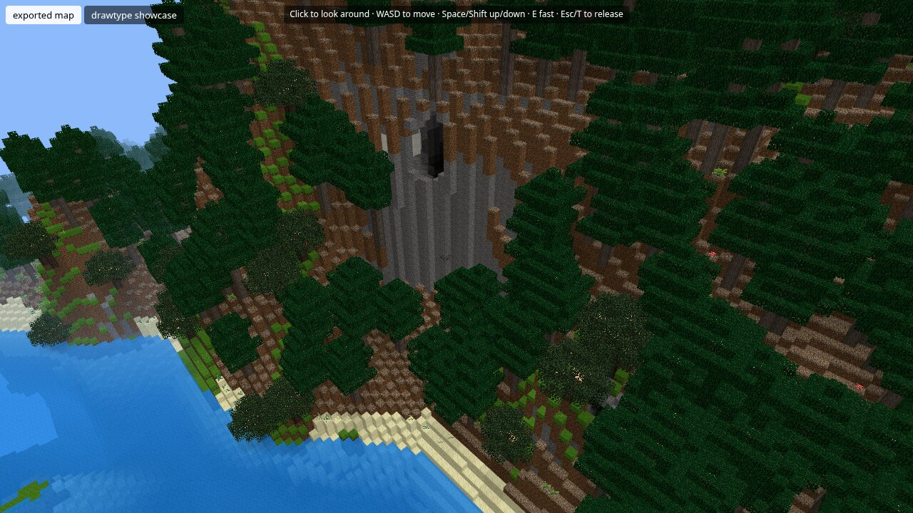

# luanti-viewer

A browser-based 3D viewer for [Luanti](https://www.luanti.org/) (formerly Minetest) maps, built on [three.js](https://threejs.org/).

It renders exported mapblocks with the node definitions, textures and models of the game they came from. It supports every drawtype (nodeboxes, meshes, liquids, plants, glass, ...), texture modifiers, animated tiles and `param2` rotations and colors.




## Usage

The package is published to the GitHub npm registry. Point the `@buckaroobanzay` scope at it in an `.npmrc` next to your `package.json`. GitHub requires a token to install packages, even public ones: a [personal access token (classic)](https://github.com/settings/tokens) with the `read:packages` scope works.

```ini
@buckaroobanzay:registry=https://npm.pkg.github.com
//npm.pkg.github.com/:_authToken=${GITHUB_TOKEN}
```

```bash
npm install @buckaroobanzay/luanti-viewer three
```

`three` is a peer dependency, so your application provides it.

`createView` renders a scene into any element. The library doesn't fetch anything itself: you provide three async callbacks that load node definitions, mapblocks and media (textures and models), so the data can come from static files, an API or anywhere else.

```html
<div id="view" style="width: 100%; height: 600px"></div>
```

```ts
import { createView, parseMapblock, type NodeDefinition } from "@buckaroobanzay/luanti-viewer"

const BASE = "https://example.com/export/"

// node name -> definition, as written by the export mod
const nodedefs: Record<string, NodeDefinition> = await fetch(BASE + "nodedefs.json").then(r => r.json())

createView(document.getElementById("view")!, {
    // called once per node name, null for unknown nodes
    getNodeDefinitions: async name => nodedefs[name] ?? null,

    // null if the mapblock does not exist
    getMapblock: async pos => {
        const response = await fetch(`${BASE}mapblocks/(${pos.x},${pos.y},${pos.z}).json`)
        return response.ok ? parseMapblock(await response.text()) : null
    },

    // textures (.png) and models (.obj / .b3d) by file name
    getMedia: async filename => {
        const response = await fetch(`${BASE}media/${encodeURIComponent(filename)}`)
        return response.ok ? response.blob() : null
    },

    // scene bounds in mapblock coordinates
    minPos: { x: -5, y: -2, z: -5 },
    maxPos: { x: 5, y: 3, z: 5 },

    // optional: only load mapblocks within this radius (in mapblocks) around the camera
    viewRange: 8,

    // optional: initial camera position and look-at point in node coordinates
    camera: {
        position: { x: 40, y: 30, z: 40 },
        target: { x: 0, y: 5, z: 0 }
    },

    // optional
    showFPS: true,
    events: {
        // reported after every frame in which the camera moved or turned,
        // can be passed back as `camera` to restore the view
        camera: camera => console.log(camera)
    }
})
```

The viewer cleans up after itself (renderer, event listeners, GPU resources) once the element is removed from the document.

### Controls

Click into the view to capture the mouse and look around.

| Key         | Action             |
|-------------|--------------------|
| W A S D     | move               |
| Space/Shift | up / down          |
| E           | move faster        |
| Esc / T     | release the mouse  |

See [src/types.ts](src/types.ts) for all `ViewerOptions` and the `NodeDefinition` format.

## Exporting a map

The [export mod](worldmods/export_mod) writes everything the viewer needs into the `mtwebview` directory of the world:

```
export/
├── nodedefs.json           # node name -> definition
├── media/                  # textures and models
└── mapblocks/
    ├── manifest.json       # { "min": {...}, "max": {...} } in mapblock coordinates
    └── (x,y,z).json        # one file per mapblock
```

The included docker-compose setup runs a Luanti server with `minetest_game`, generates a test world and exports it into `./export`:

```bash
git submodule update --init
docker compose --profile init run --rm luanti
```

## Development

```bash
npm install
npm run dev          # demo app on http://localhost:5173, serves ./export (override with EXPORT_DIR)
npm test             # unit tests
npm run typecheck
npm run build:demo   # static build of the demo into ./dist-demo
npm run build        # library build into ./dist (bundle + type declarations)
```

### Releasing

Publishing a GitHub release with a tag like `v1.2.3` runs [the publish workflow](.github/workflows/publish.yml). It tests the package, sets the version from the tag, builds it and publishes it to the GitHub npm registry. Releases marked as pre-release are published under the `next` dist-tag instead of `latest`.

The demo takes a few URL parameters: `?scene=showcase` (one example of each drawtype), `?camera=x,y,z&target=x,y,z`, `?range=4` and `?fps`.
